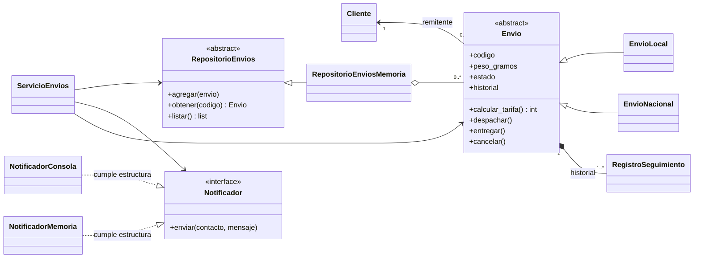

# Solución detallada — Mega taller RutaExpress

> **Material de estudio para estudiantes.** Incluye análisis resuelto, código completo y explicación de los cinco retos.
> **Requisitos:** Python 3.10 o posterior y biblioteca estándar, sin dependencias externas.

## Explicaciones para acompañar la lectura

### Clase, instancia y los cuatro pilares

`EnvioLocal` es una clase. Construir `EnvioLocal("E001", ana, "Luis - Sede centro", 1000)` crea una instancia concreta. E001 y E003 son objetos diferentes aunque pertenezcan a la misma clase.

`ESTADOS` es un atributo de clase compartido conceptualmente por los envíos. `ClassVar` expresa esa intención para las herramientas de análisis. `_codigo`, `_peso_gramos` y `_historial` son atributos de instancia. La lista histórica se crea dentro de `__init__` para que cada envío tenga la suya.

| Pilar | Aplicación | Razón |
|---|---|---|
| Abstracción | `Envio` y `RepositorioEnvios` declaran contratos | Permiten trabajar sin conocer todos los detalles |
| Encapsulamiento | Propiedades de lectura y transiciones controladas | Protegen las reglas desde la interfaz pública |
| Herencia | Local y nacional heredan de `Envio` | Reutilizan datos, validaciones y seguimiento |
| Polimorfismo | Se llama `calcular_tarifa()` sobre ambas variantes | Cada objeto aplica su fórmula sin selección externa por tipo |

El prefijo `_` es una convención de uso interno; no una prohibición absoluta de acceso en Python.

### Por qué la fórmula de bloques es correcta

`//` hace división entera. Para un peso positivo, sumar 999 antes de dividir entre 1000 permite cobrar cualquier bloque iniciado sin usar decimales.

| Peso | Cálculo | Bloques | Local | Nacional |
|---|---|---:|---:|---:|
| 1 | `1000 // 1000` | 1 | 6000 | 12000 |
| 1000 | `1999 // 1000` | 1 | 6000 | 12000 |
| 1001 | `2000 // 1000` | 2 | 7000 | 14000 |

Usar `peso // 1000 + 1` sería incorrecto: cobraría dos bloques por exactamente 1000 gramos. Las anotaciones de tipo tampoco validan por sí solas: el constructor rechaza explícitamente `bool`, porque `isinstance(True, int)` es verdadero.

### Qué protege cada colección

La lista interna del historial permite agregar entradas ordenadas. La tupla devuelta por `historial` protege su contenedor y conserva una fotografía de los registros existentes al consultarlo. Una tupla no congela los objetos que contiene; por eso los registros también usan `frozen=True`. Sus campos son cadenas y fechas inmutables. Congelar una dataclass con una lista interna no congelaría esa lista.

El diccionario del repositorio permite buscar por código y detectar duplicados. `listar()` devuelve una lista nueva: vaciarla no elimina envíos del repositorio. Sus elementos siguen siendo los mismos objetos; operar sobre uno de ellos sí cambia ese envío.

`Cliente` permanece mutable y se valida al construirlo. Consultarlo mediante una propiedad sin setter no congela sus campos. La edición de clientes queda fuera del ejercicio.

### Cómo se distribuyen las responsabilidades

El envío impide una entrega anticipada, incluso si se usa desde otro módulo. Si la regla existiera únicamente en consola, otro punto de entrada podría omitirla. El repositorio impide duplicados porque conoce la colección completa. El servicio coordina la operación y notifica después del éxito.

El estado se deriva del último registro: no se mantiene un segundo atributo que pueda contradecir al historial. Una transición rechazada lanza la excepción antes del `append`; el servicio no alcanza la notificación. Un duplicado se rechaza antes de escribir en el diccionario, por lo que tampoco reemplaza el objeto anterior.

Un nacional **es un** envío: es herencia. Un envío **tiene un** remitente: es asociación, y el mismo cliente puede participar en varios envíos. El historial es composición: el envío crea y administra sus entradas.

### Contratos nominales, estructurales, DI y DIP

`RepositorioEnviosMemoria(RepositorioEnvios)` expresa un contrato nominal mediante herencia explícita. Una subclase que no implemente los métodos abstractos no se puede instanciar.

Los dos notificadores cumplen un contrato estructural: ofrecen `enviar(contacto: str, mensaje: str) -> None` sin heredar de `Notificador`. Un analizador estático puede comprobarlo; las anotaciones no hacen esa comprobación automáticamente al ejecutar.

**DI** consiste en recibir las dependencias en `ServicioEnvios(repo, notificador)`. **DIP** consiste en que el servicio utiliza los contratos y no depende de las clases concretas. Recibir por constructor una dependencia tipada con una clase concreta demostraría DI, pero no bastaría para demostrar DIP.

### Lectura de los siete mensajes de aceptación

| Paso | Operación | Estado resultante | Entradas del envío | Mensajes acumulados |
|---|---|---|---:|---:|
| 1 | Registrar E001 | registrado | 1 | 1 |
| 2 | Registrar E002 | registrado | 1 | 2 |
| 3 | Registrar E003 | registrado | 1 | 3 |
| 4 | Despachar E001 | en_ruta | 2 | 4 |
| 5 | Entregar E001 | entregado | 3 | 5 |
| 6 | Cancelar E002 | cancelado | 2 | 6 |
| 7 | Despachar E003 | en_ruta | 2 | 7 |
| 8 | Intentar cancelar E003 | en_ruta; rechazo | 2 | 7 |

Para inspeccionar cada mensaje, agrega al `main` final, después de la historia:

```python
for contacto, mensaje in notificador.mensajes:
    print(f"{contacto} | {mensaje}")
```

El contacto será `ana@ejemplo.test` en los siete casos. Los mensajes, en orden, serán `E001: registrado`, `E002: registrado`, `E003: registrado`, `E001: en_ruta`, `E001: entregado`, `E002: cancelado` y `E003: en_ruta`.

El resumen incluye `registrado: 0` porque recorre los cuatro estados permitidos, no únicamente los presentes. Las consultas no agregan mensajes ni seguimiento. No hace falta actualizar explícitamente el repositorio tras un despacho: conserva la referencia al mismo objeto modificado.

Antes de consultar el código, intenta explicar una entrega válida y una cancelación rechazada recorriendo punto de entrada, servicio, repositorio, envío y notificador. Identifica dónde se detiene el rechazo y por qué no hace falta deshacer cambios.

## 1. Cómo usar esta solución

Primero estudia las responsabilidades y las reglas. Después reconstruye los módulos y ejecuta los escenarios. Toda la información se conserva en memoria únicamente durante la ejecución. No se incluyen archivos, bases de datos, menú, servicios externos ni pruebas unitarias.

Crea esta estructura:

```text
proyecto_rutaexpress/
    rutaexpress/
        __init__.py
        __main__.py
        excepciones.py
        modelos.py
        envios.py
        repositorios.py
        notificaciones.py
        servicio.py
```

Cada bloque de implementación corresponde a un archivo completo. Primero usa los cuatro módulos del dominio y el punto de entrada de la primera clase. Después agrega los tres módulos de integración y **reemplaza** `__main__.py` por la versión final: no concatenes ambos puntos de entrada.

Desde `proyecto_rutaexpress`, ejecuta:

```console
python -m rutaexpress
```

`__init__.py` identifica el paquete y `__main__.py` contiene el punto de entrada. Los imports con punto inicial se refieren a módulos del mismo paquete; no ejecutes los módulos internos como scripts independientes.

## 2. Análisis resuelto

**Objetivo:** registrar solicitudes, calcular tarifas consistentes, controlar estados y permitir consultas y avisos conservando el historial durante la ejecución.

### Actores, vocabulario y límites

- **Actor:** operador; registra y cambia estados en representación de RutaExpress.
- **Interesados:** remitente, destinatario y la central. En este alcance no son usuarios autenticados.
- **Envío:** solicitud sobre un solo paquete, identificada por un código.
- **Remitente:** cliente asociado a uno o más envíos.
- **Destino:** texto con destinatario y dirección; no un subsistema de geolocalización.
- **Tarifa:** valor calculado según tipo y bloques de peso; no representa un pago.
- **Seguimiento:** secuencia de estados alcanzados y sus fechas, no de intentos fallidos.
- **Despacho:** paso de registrado a en ruta.
- **Cancelación:** cierre permitido únicamente antes del despacho.

No crear `Operador` por el simple hecho de que sea un sustantivo: no se almacenan sus datos ni se implementan cuentas de acceso. Tampoco hacen falta `Pago`, `Mapa` o un repositorio de clientes.

### Requerimientos funcionales resueltos

El actor es el operador en todos los casos. R8 se ejecuta como parte de los casos exitosos R1, R3, R4 y R5.

| ID | Entradas | Precondiciones | Resultado | Rechazo |
|---|---|---|---|---|
| R1 | Tipo, código, remitente, destino, peso | Datos válidos; código nuevo; envío en registrado | Se almacena, conserva su entrada inicial y se notifica | Dato inválido, código duplicado u objeto ya avanzado |
| R2 | Código | Envío existente | Se consulta el mismo objeto con su historial | Código inválido o inexistente |
| R3 | Código | Existe y está registrado | Pasa a en ruta, agrega seguimiento y notifica | Inexistente o transición prohibida |
| R4 | Código | Existe y está en ruta | Pasa a entregado, agrega seguimiento y notifica | Inexistente o transición prohibida |
| R5 | Código | Existe y está registrado | Pasa a cancelado, agrega seguimiento y notifica | Inexistente o transición prohibida |
| R6 | Estado | Estado conocido | Lista nueva de coincidencias, posiblemente vacía | Estado inválido |
| R7 | Ninguna | Ninguna | Diccionario con los cuatro estados y sus cantidades | No hay rechazo de negocio para esta consulta |
| R8 | Contacto y mensaje generados por el sistema | Registro o transición exitosos | Mensaje mostrado o acumulado según adaptador | No se invoca ante rechazos de negocio |

### Responsabilidades y colaboradores

| Concepto | Qué conoce | Qué hace | Colabora con |
|---|---|---|---|
| Cliente | Identificación, nombre, contacto | Valida y normaliza sus datos al construirse | Envío lo referencia como remitente |
| Registro de seguimiento | Estado alcanzado, fecha | Conserva una entrada histórica sin reasignación de campos | Envío |
| Envío | Código, remitente, destino, peso, historial | Protege transiciones; consulta estado; define contrato de tarifa | Cliente y registros |
| Envío local/nacional | Regla de tarifa específica | Calcula sin cambiar el flujo común | Hereda de Envío |
| Repositorio | Colección indexada por código | Agrega sin sobrescribir; recupera y lista | Envío |
| Servicio | Contratos de almacenamiento y notificación | Coordina casos de uso y reportes | Repositorio, notificador y envío |
| Notificador | Contacto y mensaje | Muestra o acumula información | Servicio |

**Decisiones que conviene discutir:**

- `EnvioNacional` **es un** `Envio`; no hereda de `Cliente`.
- Un envío **tiene un** remitente y registros históricos.
- El historial pertenece al envío. No debe alterarse desde la consola ni desde el repositorio.
- El estado se deriva de la última entrada histórica: así no mantenemos dos fuentes de verdad.
- La unicidad de código pertenece a la colección, no al constructor de un objeto aislado.
- Los datos del cliente se modelan con dataclass; el envío tiene un ciclo de vida protegido con una clase tradicional.
- `Cliente` es mutable en esta solución; solo se validan sus datos iniciales. Editar clientes no es un caso de uso.

### Modelo conceptual antes de la arquitectura

Un cliente puede ser remitente de cero o muchos envíos; cada envío tiene un remitente. Cada envío tiene una o más entradas de seguimiento. Un envío es local o nacional, nunca ambos en este alcance.

El siguiente diagrama reúne el dominio y los componentes técnicos de la solución:



La realización punteada del protocolo representa cumplimiento estructural, **no herencia escrita en Python**.

### Estados y recorrido de responsabilidades

```text
registrado --despachar--> en_ruta --entregar--> entregado
     |
     +------cancelar------------------------> cancelado
```

**Entrega exitosa:** consola solicita al servicio; servicio obtiene el envío; envío verifica su estado y agrega un registro; servicio notifica. El repositorio en memoria conserva la referencia al objeto, por lo que no necesita un método de actualización adicional.

**Cancelación rechazada:** el servicio obtiene un envío en ruta; el envío lanza `TransicionInvalida` antes de agregar seguimiento; no se alcanza la notificación; la consola informa el rechazo. No se borra ni se restaura un historial: nunca se modificó.

---

## 3. Implementación del dominio

Los bloques siguientes son archivos completos. Conserva los nombres y los imports relativos. Las propiedades públicas son de lectura; el prefijo `_` marca implementación interna por convención de Python, no una barrera absoluta de seguridad.

### `rutaexpress\__init__.py`

```python
# rutaexpress\__init__.py
"""Modelo y casos de uso de RutaExpress."""
```

No importar el servicio desde aquí todavía: en el cierre de clase 1 ese módulo no existe.

### `rutaexpress\excepciones.py`

```python
# rutaexpress\excepciones.py
class RutaExpressError(Exception):
    """Error de negocio de RutaExpress."""


class DatoInvalido(RutaExpressError):
    """Un dato obligatorio no cumple su contrato."""


class CodigoDuplicado(RutaExpressError):
    """El código ya está registrado."""


class EnvioNoEncontrado(RutaExpressError):
    """No existe un envío con ese código."""


class TransicionInvalida(RutaExpressError):
    """La operación no está permitida desde el estado actual."""
```

**Pregunta:** ¿por qué no devolver `False` en todos los errores?  
**Respuesta:** los errores específicos permiten distinguir causas; no se confunden con un resultado válido y se manejan en la frontera de la aplicación.

### `rutaexpress\modelos.py`

```python
# rutaexpress\modelos.py
from dataclasses import dataclass, field
from datetime import datetime

from .excepciones import DatoInvalido


def validar_texto(valor: str, campo: str) -> str:
    if not isinstance(valor, str) or not valor.strip():
        raise DatoInvalido(f"{campo} debe ser un texto no vacío")
    return valor.strip()


@dataclass
class Cliente:
    identificacion: str
    nombre: str
    contacto: str

    def __post_init__(self) -> None:
        self.identificacion = validar_texto(self.identificacion, "Identificación")
        self.nombre = validar_texto(self.nombre, "Nombre")
        self.contacto = validar_texto(self.contacto, "Contacto")


@dataclass(frozen=True)
class RegistroSeguimiento:
    estado: str
    fecha: datetime = field(default_factory=datetime.now)
```

**Solución del reto 1:** `RegistroSeguimiento`. `default_factory` se llama al construir cada registro; `default=datetime.now()` evaluaría una sola fecha al definir la clase. `frozen=True` evita reasignar estado o fecha. No introduce validación automática de tipos.

Aquí los registros se crean desde las transiciones controladas, no desde entradas arbitrarias del operador. Sus campos son `str` y `datetime`, sin listas mutables anidadas.

### `rutaexpress\envios.py`

```python
# rutaexpress\envios.py
from abc import ABC, abstractmethod
from typing import ClassVar

from .excepciones import DatoInvalido, TransicionInvalida
from .modelos import Cliente, RegistroSeguimiento, validar_texto


class Envio(ABC):
    ESTADOS: ClassVar[tuple[str, ...]] = (
        "registrado",
        "en_ruta",
        "entregado",
        "cancelado",
    )

    def __init__(
        self,
        codigo: str,
        remitente: Cliente,
        destino: str,
        peso_gramos: int,
    ) -> None:
        self._codigo = validar_texto(codigo, "Código")
        self._destino = validar_texto(destino, "Destino")
        if not isinstance(remitente, Cliente):
            raise DatoInvalido("El remitente debe ser un Cliente")
        if (
            not isinstance(peso_gramos, int)
            or isinstance(peso_gramos, bool)
            or peso_gramos <= 0
        ):
            raise DatoInvalido("El peso debe ser un entero positivo en gramos")
        self._remitente = remitente
        self._peso_gramos = peso_gramos
        self._historial: list[RegistroSeguimiento] = [
            RegistroSeguimiento("registrado")
        ]

    @property
    def codigo(self) -> str:
        return self._codigo

    @property
    def remitente(self) -> Cliente:
        return self._remitente

    @property
    def destino(self) -> str:
        return self._destino

    @property
    def peso_gramos(self) -> int:
        return self._peso_gramos

    @property
    def estado(self) -> str:
        return self._historial[-1].estado

    @property
    def historial(self) -> tuple[RegistroSeguimiento, ...]:
        return tuple(self._historial)

    def _bloques_peso(self) -> int:
        return (self._peso_gramos + 999) // 1000

    def _transicionar(self, origen: str, destino: str) -> None:
        if self.estado != origen:
            raise TransicionInvalida(
                f"{self.codigo}: no se puede pasar de {self.estado} a {destino}"
            )
        self._historial.append(RegistroSeguimiento(destino))

    def despachar(self) -> None:
        self._transicionar("registrado", "en_ruta")

    def entregar(self) -> None:
        self._transicionar("en_ruta", "entregado")

    def cancelar(self) -> None:
        self._transicionar("registrado", "cancelado")

    @abstractmethod
    def calcular_tarifa(self) -> int:
        """Calcula el valor en pesos enteros."""


class EnvioLocal(Envio):
    def __init__(
        self,
        codigo: str,
        remitente: Cliente,
        destino: str,
        peso_gramos: int,
    ) -> None:
        super().__init__(codigo, remitente, destino, peso_gramos)

    def calcular_tarifa(self) -> int:
        return 5000 + 1000 * self._bloques_peso()


class EnvioNacional(Envio):
    def __init__(
        self,
        codigo: str,
        remitente: Cliente,
        destino: str,
        peso_gramos: int,
    ) -> None:
        super().__init__(codigo, remitente, destino, peso_gramos)

    def calcular_tarifa(self) -> int:
        return 10000 + 2000 * self._bloques_peso()
```

**Solución del reto 2:** `EnvioNacional`. Los constructores de las variantes se escriben explícitamente para practicar `super()`; al no añadir datos propios, también podrían heredar el constructor sin sobrescribirlo. Esa repetición es didáctica, no una necesidad del lenguaje.

**Preguntas resueltas:**

- ¿Por qué `Envio` es abstracta? No hay una tarifa genérica válida; cada variante implementa el contrato.
- ¿Por qué `isinstance` para validar peso no contradice el reto? Valida un dato de entrada; no selecciona una tarifa por tipo de envío.
- ¿Por qué el historial no es atributo de clase? Cada envío necesita su propia lista.
- ¿Por qué devolver una tupla? Evita agregar o quitar entradas sobre la lista interna. Los registros congelados evitan reasignar sus campos.
- ¿Por qué validar antes de `append`? El rechazo deja el objeto intacto.
- ¿Por qué derivar estado del último registro? Reduce la posibilidad de contradicción entre estado e historial.

## 4. Punto de control de la primera clase

Usa los cuatro archivos anteriores y este **primer** `__main__.py`. No necesita repositorio, notificador ni servicio. Antes de la segunda clase, guarda la evidencia de este recorrido; después se reemplaza únicamente el punto de entrada por el de la sección 6.

```python
# cierre_clase_1: rutaexpress\__main__.py
from .envios import Envio, EnvioLocal, EnvioNacional
from .excepciones import TransicionInvalida
from .modelos import Cliente


def main() -> None:
    ana = Cliente("C001", "Ana", "ana@ejemplo.test")
    for peso in (1, 1000, 1001):
        variantes: list[Envio] = [
            EnvioLocal(f"L{peso}", ana, "Luis - Sede centro", peso),
            EnvioNacional(f"N{peso}", ana, "Sara - Sede norte", peso),
        ]
        tarifas = [envio.calcular_tarifa() for envio in variantes]
        print(f"{peso} g | local={tarifas[0]} | nacional={tarifas[1]}")

    local = EnvioLocal("E001", ana, "Luis - Sede centro", 1000)
    nacional = EnvioNacional("E002", ana, "Sara - Sede norte", 1001)
    local.despachar()
    local.entregar()
    nacional.cancelar()
    for envio in (local, nacional):
        print(f"{envio.codigo} | {envio.estado} | {len(envio.historial)}")

    pendiente = EnvioLocal("E003", ana, "Eva - Sede sur", 1)
    antes = pendiente.historial
    try:
        pendiente.entregar()
    except TransicionInvalida as error:
        print(f"RECHAZO: {error}")
    else:
        print("Entrega realizada")
    finally:
        print("Fin del intento")
    print(f"Historial sin cambios: {pendiente.historial == antes}")
    print(f"Historiales independientes: {len(local.historial)}, {len(pendiente.historial)}")


if __name__ == "__main__":
    main()
```

Desde la carpeta que contiene `rutaexpress`, ejecutar `python -m rutaexpress`.

Salida:

```text
1 g | local=6000 | nacional=12000
1000 g | local=6000 | nacional=12000
1001 g | local=7000 | nacional=14000
E001 | entregado | 3
E002 | cancelado | 2
RECHAZO: E003: no se puede pasar de registrado a entregado
Fin del intento
Historial sin cambios: True
Historiales independientes: 3, 1
```

`finally` señala el cierre del intento tanto si se acepta como si se rechaza; no sustituye la notificación de negocio. El mensaje de `else` solo aparece al ejecutar una entrega permitida.

---

## 5. Repositorio, notificaciones y servicio

Conservar los cuatro módulos de la primera clase, agregar los tres siguientes y reemplazar el punto de entrada como indica la sección 6.

### `rutaexpress\repositorios.py`

```python
# rutaexpress\repositorios.py
from abc import ABC, abstractmethod

from .envios import Envio
from .excepciones import CodigoDuplicado, EnvioNoEncontrado
from .modelos import validar_texto


class RepositorioEnvios(ABC):
    @abstractmethod
    def agregar(self, envio: Envio) -> None:
        """Agrega un código nuevo sin sobrescribir."""

    @abstractmethod
    def obtener(self, codigo: str) -> Envio:
        """Recupera un envío existente."""

    @abstractmethod
    def listar(self) -> list[Envio]:
        """Retorna una lista nueva con los envíos."""


class RepositorioEnviosMemoria(RepositorioEnvios):
    def __init__(self) -> None:
        self._envios: dict[str, Envio] = {}

    def agregar(self, envio: Envio) -> None:
        if envio.codigo in self._envios:
            raise CodigoDuplicado(f"El código {envio.codigo} ya existe")
        self._envios[envio.codigo] = envio

    def obtener(self, codigo: str) -> Envio:
        codigo = validar_texto(codigo, "Código")
        if codigo not in self._envios:
            raise EnvioNoEncontrado(f"No existe el envío {codigo}")
        return self._envios[codigo]

    def listar(self) -> list[Envio]:
        return list(self._envios.values())
```

La copia protege el contenedor. No se promete una copia profunda ni un repositorio de objetos inmutables: los envíos siguen respondiendo a operaciones de dominio. El contrato de `obtener` no devuelve `None`; el servicio no debe fingir éxito ante un inexistente.

### `rutaexpress\notificaciones.py`

```python
# rutaexpress\notificaciones.py
from typing import Protocol


class Notificador(Protocol):
    def enviar(self, contacto: str, mensaje: str) -> None:
        ...


class NotificadorConsola:
    def enviar(self, contacto: str, mensaje: str) -> None:
        print(f"AVISO a {contacto}: {mensaje}")


class NotificadorMemoria:
    def __init__(self) -> None:
        self._mensajes: list[tuple[str, str]] = []

    @property
    def mensajes(self) -> tuple[tuple[str, str], ...]:
        return tuple(self._mensajes)

    def enviar(self, contacto: str, mensaje: str) -> None:
        self._mensajes.append((contacto, mensaje))
```

**Solución del reto 4:** `NotificadorMemoria`. Ambas clases cumplen la firma sin heredar del protocolo. `Protocol` expresa el contrato para el análisis estático; por sí solo no inspecciona ni valida firmas al ejecutar. No se necesita `@runtime_checkable` para esta actividad.

El `print` pertenece al adaptador de presentación, no al modelo de negocio. La lista de mensajes también es por instancia y se consulta mediante una tupla.

### `rutaexpress\servicio.py`

```python
# rutaexpress\servicio.py
from .envios import Envio
from .excepciones import DatoInvalido, TransicionInvalida
from .modelos import validar_texto
from .notificaciones import Notificador
from .repositorios import RepositorioEnvios


class ServicioEnvios:
    def __init__(
        self,
        repo: RepositorioEnvios,
        notificador: Notificador,
    ) -> None:
        self._repo = repo
        self._notificador = notificador

    def _notificar(self, envio: Envio) -> None:
        self._notificador.enviar(
            envio.remitente.contacto,
            f"{envio.codigo}: {envio.estado}",
        )

    def registrar(self, envio: Envio) -> None:
        if envio.estado != "registrado":
            raise TransicionInvalida("Solo se registran envíos nuevos")
        self._repo.agregar(envio)
        self._notificar(envio)

    def consultar(self, codigo: str) -> Envio:
        return self._repo.obtener(codigo)

    def despachar(self, codigo: str) -> None:
        envio = self.consultar(codigo)
        envio.despachar()
        self._notificar(envio)

    def entregar(self, codigo: str) -> None:
        envio = self.consultar(codigo)
        envio.entregar()
        self._notificar(envio)

    def cancelar(self, codigo: str) -> None:
        envio = self.consultar(codigo)
        envio.cancelar()
        self._notificar(envio)

    def filtrar_por_estado(self, estado: str) -> list[Envio]:
        estado = validar_texto(estado, "Estado")
        if estado not in Envio.ESTADOS:
            raise DatoInvalido(f"Estado desconocido: {estado}")
        return [
            envio
            for envio in self._repo.listar()
            if envio.estado == estado
        ]

    def resumen_por_estado(self) -> dict[str, int]:
        envios = self._repo.listar()
        return {
            estado: sum(1 for envio in envios if envio.estado == estado)
            for estado in Envio.ESTADOS
        }
```

**Solución del reto 3:** entregar/cancelar delegan la transición y notifican después. No hay un `try/except` que silencie el rechazo.

**Solución del reto 5:** el filtro es una list comprehension y el resumen una dict comprehension. `sum` cuenta coincidencias mediante una expresión generadora; se puede explicar como “sumar uno por cada coincidencia”. Un repositorio vacío produce los cuatro estados con cero.

**DI frente a DIP:**

- **DI:** las dependencias se reciben por constructor, no se crean dentro del servicio.
- **DIP:** el servicio importa y utiliza los contratos `RepositorioEnvios` y `Notificador`, no las clases concretas.
- Pasar una concreción por constructor consigue DI, pero no demuestra por sí solo DIP si el servicio sigue dependiendo de su tipo concreto.
- Las concreciones se eligen en `__main__.py`, el punto de composición.

**Límite deliberado:** no se implementan transacciones distribuidas ni recuperación de fallos externos. Para los dos adaptadores locales previstos, primero se aplica la operación y luego se notifica. Si en un proyecto futuro un adaptador real falla, ese error no debe ocultarse ni confundirse con un rechazo de negocio que dejó todo intacto; exigiría un alcance adicional.

## 6. Punto de entrada final

Este bloque es la versión final de `__main__.py`. No debe concatenarse con el cierre anterior.

```python
# rutaexpress\__main__.py
from .envios import EnvioLocal, EnvioNacional
from .excepciones import (
    CodigoDuplicado,
    EnvioNoEncontrado,
    TransicionInvalida,
)
from .modelos import Cliente
from .notificaciones import Notificador, NotificadorMemoria
from .repositorios import RepositorioEnviosMemoria
from .servicio import ServicioEnvios


def ejecutar_historia(notificador: Notificador) -> ServicioEnvios:
    repo = RepositorioEnviosMemoria()
    servicio = ServicioEnvios(repo, notificador)
    ana = Cliente("C001", "Ana", "ana@ejemplo.test")
    servicio.registrar(EnvioLocal("E001", ana, "Luis - Sede centro", 1000))
    servicio.registrar(EnvioNacional("E002", ana, "Sara - Sede norte", 1001))
    servicio.registrar(EnvioLocal("E003", ana, "Eva - Sede sur", 1))
    servicio.despachar("E001")
    servicio.entregar("E001")
    servicio.cancelar("E002")
    servicio.despachar("E003")

    for envio in repo.listar():
        print(
            f"{envio.codigo} | {envio.estado} | "
            f"{envio.calcular_tarifa()} | {len(envio.historial)}"
        )
    print(servicio.resumen_por_estado())
    return servicio


def main() -> None:
    notificador = NotificadorMemoria()
    servicio = ejecutar_historia(notificador)
    print(f"Mensajes: {len(notificador.mensajes)}")

    antes = servicio.consultar("E003").historial
    try:
        servicio.cancelar("E003")
    except TransicionInvalida as error:
        print(f"RECHAZO: {error}")
    else:
        print("Cancelación realizada")
    finally:
        print("Fin del intento")
    print(f"Historial sin cambios: {servicio.consultar('E003').historial == antes}")

    ana = Cliente("C001", "Ana", "ana@ejemplo.test")
    try:
        servicio.registrar(EnvioLocal("E001", ana, "Otro destino", 1000))
    except CodigoDuplicado as error:
        print(f"RECHAZO: {error}")

    try:
        servicio.consultar("NO-EXISTE")
    except EnvioNoEncontrado as error:
        print(f"RECHAZO: {error}")

    for estado, cantidad in servicio.resumen_por_estado().items():
        print(f"{estado}: {cantidad}")
    en_ruta = servicio.filtrar_por_estado("en_ruta")
    print(f"En ruta: {[envio.codigo for envio in en_ruta]}")
    print(f"Mensajes después de rechazos y consultas: {len(notificador.mensajes)}")


if __name__ == "__main__":
    main()
```

Ejecutar nuevamente `python -m rutaexpress` desde la carpeta que contiene el paquete.

Salida completa:

```text
E001 | entregado | 6000 | 3
E002 | cancelado | 14000 | 2
E003 | en_ruta | 6000 | 2
{'registrado': 0, 'en_ruta': 1, 'entregado': 1, 'cancelado': 1}
Mensajes: 7
RECHAZO: E003: no se puede pasar de en_ruta a cancelado
Fin del intento
Historial sin cambios: True
RECHAZO: El código E001 ya existe
RECHAZO: No existe el envío NO-EXISTE
registrado: 0
en_ruta: 1
entregado: 1
cancelado: 1
En ruta: ['E003']
Mensajes después de rechazos y consultas: 7
```

### Demostrar sustitución sin tocar el servicio

`ejecutar_historia` solo requiere `Notificador`. Para el recorrido en consola, importar también `NotificadorConsola` desde `.notificaciones` y ejecutar `ejecutar_historia(NotificadorConsola())` en el punto de entrada. Ese recorrido crea un repositorio nuevo; no vuelve a registrar códigos sobre el repositorio anterior.

No modificar `ServicioEnvios`, sus métodos, el dominio ni el contrato. Aparecerán siete líneas adicionales con formato `AVISO a ana@ejemplo.test: E001: registrado`, según cada operación.

La propiedad `mensajes` pertenece al adaptador de memoria, no al protocolo. Las líneas que cuentan mensajes en `main` son inspección específica de ese adaptador: se omiten en la demostración de consola. No exigir que `NotificadorConsola` invente un almacenamiento que no necesita.

La firma común de ambos adaptadores es `enviar(contacto: str, mensaje: str) -> None`. No afirmar que ejecutar el programa equivale a una comprobación estática de tipos.

---

## 7. Comprobaciones manuales y errores frecuentes

### Recorridos adicionales para estudiar

| Escenario | Comprobación concreta |
|---|---|
| Repositorio vacío | `listar()` retorna `[]`; resumen contiene cuatro ceros |
| Pesos 1, 1 000 y 1 001 | Local 6 000/6 000/7 000; nacional 12 000/12 000/14 000 |
| Peso 0, negativo, decimal, texto o bool | `DatoInvalido`, sin agregar objeto al sistema |
| Texto obligatorio vacío o solo espacios | `DatoInvalido` |
| Código con espacios exteriores | Se normaliza; una variante con los mismos caracteres normalizados es duplicada |
| Código en minúsculas | Es distinto de su variante en mayúsculas |
| Entrega anticipada | Error; estado e historial permanecen iguales |
| Segundo despacho | Error; no se agrega seguimiento ni mensaje |
| Cancelación posterior al despacho | Error; no se agrega seguimiento ni mensaje |
| Operación sobre entregado/cancelado | Error; ambos siguen consultables |
| Registro de objeto que ya avanzó de estado | `TransicionInvalida`; no se agrega ni notifica |
| Código inexistente en consulta o transición | `EnvioNoEncontrado`; no se modifica otro envío |
| Filtro válido sin coincidencias | Lista vacía |
| Filtro desconocido | `DatoInvalido`, no lista vacía |
| Modificar lista de `listar()` o filtro | El repositorio conserva sus elementos |
| Consultar historial y luego cambiar envío | La tupla anterior conserva la fotografía de ese momento |
| Intentar reasignar un registro congelado | `FrozenInstanceError`; no se altera el historial |
| Dos envíos y dos notificadores memoria | Sus listas internas no se comparten |

No comparar fechas contra una cadena fija. `datetime.now` usa la hora local del equipo y puede producir marcas iguales en operaciones muy próximas; no se requiere una diferencia mínima entre registros. El orden del historial es el orden de las operaciones.

### Errores que no conviene resolver copiando más código

| Error de implementación | Pregunta orientadora |
|---|---|
| Decide tarifa con `if` según tipo en el servicio | ¿Qué método podría responder cada envío? |
| Declara `_historial = []` en la clase | ¿Qué pasa cuando dos objetos agregan registros? |
| Devuelve directamente `_historial` | ¿Qué podría hacer otro módulo con esa referencia? |
| Congela una dataclass que contiene una lista y afirma inmutabilidad total | ¿Congelar el campo congela también el contenido? |
| Guarda `_estado` y olvida actualizarlo | ¿Necesitamos duplicar una información ya disponible? |
| Notifica antes de validar | ¿Qué mensaje queda después de un rechazo? |
| Usa `except Exception` para continuar | ¿Qué defecto de programación estaríamos escondiendo? |
| El servicio crea `RepositorioEnviosMemoria()` internamente | ¿Cómo lo sustituiríamos sin editar el servicio? |
| El notificador hereda innecesariamente del protocolo | ¿Qué condición estructural necesita cumplir realmente? |
| Hace imports con `*` o ejecuta módulos internos como scripts sueltos | ¿Cuál es la raíz del paquete y su punto de entrada? |

## 8. Relación entre teoría y código

| Tema de teoría | Evidencia del taller |
|---|---|
| 1. Conceptos POO | Análisis y distinción clase/instancia; recorrido de mensajes entre objetos |
| 2. Clases, atributos y métodos | Constructor, `ESTADOS` de clase, historial por instancia y propiedades |
| 3. Cuatro pilares | Abstracción ABC, encapsulamiento y variantes con despacho polimórfico |
| 4.1 Listas | Historial, colección de variantes y filtro por comprehension |
| 4.2 Tuplas | Estados, fotografías históricas, pares de mensajes y desempaquetado de `items()` |
| 4.3 Diccionarios | Repositorio indexado y resumen por dict comprehension |
| Dataclasses | Cliente con `__post_init__`; seguimiento congelado con `default_factory` |
| 5. Modularización y abstracción | Módulos con responsabilidades separadas y contratos pequeños |
| 5.1 Herencia y polimorfismo | EnvioLocal/EnvioNacional; mismo mensaje `calcular_tarifa()` |
| 5.2 Protocolos e interfaces | Comparación repositorio nominal y notificador estructural |
| 5.3 DI y DIP | Servicio recibe contratos; composición y sustitución externas |
| 6. Módulos y paquetes | Imports relativos, `__init__`, `__main__` y `python -m rutaexpress` |
| 7. Excepciones | Jerarquía, `raise`, capturas específicas, `else` y `finally` |
| Análisis del mundo del problema | Requerimientos, glosario, responsabilidades, multiplicidades y transiciones |
